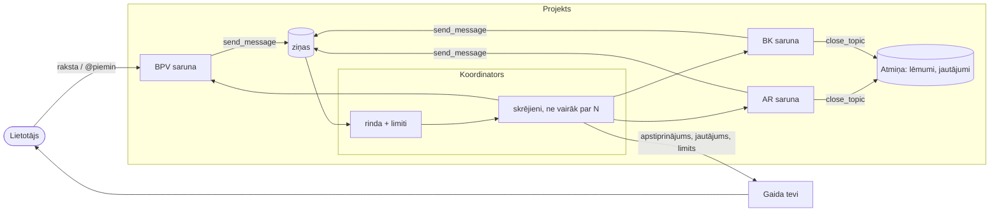

# Agent sessions and messages — design

Date: 2026-11-13. Author: Claude, for the user. Status: **for the user's approval. Nothing is built until it is approved.**
Reads with: `v2-design.md` (decisions and tool levels), `v2-work-plan.md` (phase 8.15 and phase 9), `docs/BD/` (the office's agent team description and `projektesanas_process.md`).
Language rule as in `v2-design.md`: English prose; Latvian for UI strings, domain terms and file names. No real project data and no people's names in this file.

## Intent

Every agent in a project becomes a co-worker with a conversation of its own. The user can open that conversation and talk to that agent. Agents leave each other messages, and a message starts the recipient's work. All of it is visible, bounded, stoppable, and still there after the app is closed.

One runtime serves two ways of working:

- **Co-work (now).** The user steers: opens the architect's thread, asks the constructor something, lets two agents settle a detail, watches and corrects.
- **Production (later).** The būvprojekta vadītājs agent (BPV) runs the office's process (`docs/BD/projektesanas_process.md`: stages S1–S7, human gates H1–H7) on top of the same threads and messages, once the skills and workflows are proven.

Why now: the production goal needs this infrastructure whatever the agents' skills become, and today's runtime cannot carry it (see "What exists today").

## The picture

An office analogy, used for the names in this document:

| Runtime thing | In an office |
|---|---|
| **Agent** | a person with a role, a desk and their own know-how |
| **Thread** (saruna) | one job folder on that person's desk: one topic, one conversation |
| **Message** (ziņa) | a note left on a colleague's desk; they pick it up and start |
| **Topic** (temats) | the subject two people are settling; closed with an agreement or passed up |
| **Wave** (vilnis) | everything set in motion by one thing the user said |
| **Coordinator** (dispečers) | the office manager: who works now, who waits, when to stop and ask the user |
| **Room** (telpa) | the open office: the user sees who is doing what and who is waiting for whom |

## Goals

1. **An agent is an identity**: a code (BPV, AR, BK …), a role text, tools, its own knowledge, optionally its own model.
2. **A thread per agent and topic**, stored on disk, with its own history, its own compaction and its own confirmation prompts.
3. **The user can talk to any agent**: open its thread, or `@AR` from anywhere.
4. **Agents message each other**, and a message starts the recipient's run without the user doing anything.
5. **Several agents work at once**, up to a cap; their writes take turns.
6. **Hard limits that code enforces**, not prompts: exchanges per topic, depth of a chain, runs and cost per wave.
7. **One Stop for everything**, and a stop per thread.
8. **Survives a restart**: threads, messages and the waiting queue are on disk. Nothing starts again by itself.
9. **Agreements land in the project's memory** (Atmiņa), not only in a conversation.
10. **The process layer fits on top later** without changing threads or messages.

## Non-goals

- **The agents themselves.** Turning the office's 16 role descriptions into agents, the extra roles (BIM koordinators, Revit modelētājs, rasētājs, skeptiķis) and the roughly 100 skills are separate work. This design only makes sure the spec format can hold them.
- **Always-on work**: scheduled runs, or runs while the app is closed. The scheduler stays in "Later" of the work plan.
- **The page layout.** The user is reworking it (phase 9 and after). This design defines the data and events the chat needs and a minimum to use them; where it sits on screen is the user's.
- **Sharing between users.** Single-user stays (`v2-design.md` decision 13).
- **Agents as separate programs** messaging each other outside the app.

## Anti-goals

- Agents talking in circles and spending tokens while nobody watches.
- The truth of a project living in conversation scroll-back.
- Two agents changing the same thing at once, or an agent approving its own Revit batch.
- A reviewing agent (ekspertīze) that has seen the working conversations it is meant to judge.
- A stream so busy that the answer is hidden.

## What exists today (read in the code, 2026-11-13)

| Area | State | Where |
|---|---|---|
| Conversations | One per project, kept in memory, keyed by project id; the transcript is one `chat/<project>.jsonl` | `src/agent/session.ts` (`conversations`, `chatFile`) |
| Runs | One at a time for the whole app: `send` refuses while `running` is set | `session.ts` `send` |
| After a restart | The conversation is rebuilt from the newest compaction summary plus the last ten transcript lines; tool results are not kept | `session.ts` `transcriptSeed` |
| Helpers | `run_subagent` (read-only) and `delegate` (named specialists, may write up to level `run`). Each is a lane inside the main run: empty history every time, cannot see another lane, cannot start one, reports once | `src/agent/subagents.ts` |
| Specialists | `AgentSpec`: id, name, description, prompt (10–4000 characters), tools. Three shipped. Edited in Iestatījumi → Aģenti | `subagents.ts`, `src/shared/agent-types.ts` |
| Approval | One `Gate` per run; `confirm` tools ask the user per batch. A lane's gate answers every confirmation with no, so lanes never reach `confirm` tools (all Revit create and modify tools) | `src/agent/tools/levels.ts`, `subagents.ts`, `tools/revit-levels.ts` |
| Write locks | `WriteLocks` keyed `staging` / `store` / `revit`. A new instance per run; only lanes take them, the main run's own writes do not | `src/agent/locks.ts`, `session.ts` |
| Who wrote it | `Who` is `user` / `agent` / `app`; a tool call's log entry carries the run and the tool through `ToolScope` | `src/core/model.ts`, `src/core/scope.ts` |
| Project memory | Atmiņa notes, one markdown file each, types `decision` / `answer` / `learning` / `question` | `src/core/notes.ts`, `model.ts` `Note` |
| Office memory | Notes that hold for every project; an agent's note waits as a proposal until the user accepts it | `src/core/office-memory.ts` |
| Tasks | The agent proposes, the user accepts, finishes or drops | `src/core/tasks.ts` |
| Events | `agent.event { runId, event }`; a `lane` event for helpers; the activity log turns them into readable lines | `src/shared/types.ts`, `src/main/activity.ts` |
| Fixed context | Guarded under 10 000 tokens per request | `test/0.6-session-context.test.ts` |

So the registers the office's process asks for (lēmumu žurnāls, jautājumu žurnāls, agent knowledge) are mostly here already as notes. What is missing is the runtime: more than one conversation, more than one run, and a way for one agent's output to start another.

## Approaches

Three ways were considered.

1. **Journals on today's helpers.** BPV stays the one main agent. Helpers get the office's task format and one new tool, `ask_agent`, that runs another agent inside the same run. Small: it lifts "no nesting" in one controlled place. But nobody can talk to a single agent, helpers still cannot reach `confirm` tools (so no Revit modelling, which is the whole output of stage S4), and everything dies with the run when the app closes.
2. **Agent sessions with a mailbox.** Each agent has stored threads; a message goes to the recipient's thread and queues a run for it; a coordinator decides who runs. Large: it ends "one conversation per project, one run at a time". It gives per-agent confirmation, survives a restart, and lets the user address any agent.
3. **Separate programs messaging each other** (the way some coding CLIs let sessions hand work over). Dropped: the approval gate, the tool levels, the write locks and the sign-in all live in the app's main process, and separate programs would be outside them.

**Picked: 2** (the user, 2026-11-13): "best fit for the goal of project production automated when we perfect all skills and workflows, but still can be used more like co-work style I am planning now."

Both 1 and 2 need the same first layer (threads on disk, attribution, locks for every run), so that is built first and changes no behaviour.

## Design

### 1. Agents

`AgentSpec` grows; the three shipped specialists keep working unchanged.

| Field | Meaning |
|---|---|
| `id` | the code used everywhere: `bpv`, `ar`, `bk` … (today's rule: lower-case letters, digits, hyphen) |
| `name`, `description` | as today; the description is the roster line other agents see |
| `role` | the agent's role text as a markdown file in the app's data folder, not a 4000-character field. The office's role descriptions are 7–10 KB each |
| shared rules | one file all agents get (the office's "kopējie darba noteikumi"), stored once, not pasted into each role |
| `tools` | as today: tools beyond reading |
| `maxLevel` | `run` (default) or `confirm`. An agent with `confirm` may call Revit create and modify tools; the user still confirms every batch |
| `model`, `effort` | optional; empty means the user's setting |
| `mayMessage`, `acceptsFrom` | who this agent may write to and from whom it takes messages; empty means everyone. This is what makes a walled agent |
| `skills` | the skills this agent is told about. Added 2026-11-13 when the office's 120 skills arrived (`docs/BD/skilli/`): the whole list no longer fits in any agent's standing text, and a skill with unfilled placeholders or an unchecked test example is a draft that no agent is given |

The agent the user talks to by default is the **lead**. Today's single conversation becomes the lead's first thread, read from the existing transcript file as it is.

Each agent's fixed context (shared rules + role + roster + skills list + tool declarations) is measured and shown on the Aģenti page, with a guard in the tests, as the lead's is today.

### 2. Threads

A thread is one agent's conversation on one topic in one project.

- **Stored** in the project's data folder: one folder per thread with its facts (agent, title, topic, state, who started it, counters) and its transcript in today's `ChatEntry` format. Threads without a project go beside the settings, as the chat does today.
- **State**: `idle`, `queued`, `running`, `waiting-confirm` (a batch awaits the user), `waiting-reply` (it asked another agent), `interrupted` (the app closed mid-run), `closed`.
- **Context** works as today, per thread: messages in memory while the app runs, old screenshots and tool results trimmed, a summary at the compaction line, and after a restart the summary plus the last lines.
- **Lifetime.** A thread belongs to a task or a topic. A closed thread stays readable and searchable but no longer feeds any agent's context. A new task starts a new thread that reads the project's current state and the agent's knowledge, not old threads. This follows the office rule that project state is in the registers and not in correspondence. In co-work the user may also keep one long thread with an agent; it compacts as the chat does today.
- **No agent reads another agent's thread.** There is no tool for it. What another agent needs to know arrives as a message or stands in Atmiņa.

### 3. Runs and the coordinator

The single `running` slot in `AgentSession` goes. Its work splits in two:

- **Thread runner**: what `AgentSession.run` does now, for one thread: build the prompt, the gate, compaction, the pi run, the transcript.
- **Coordinator**: one per app, in the main process. It owns the table of runs, the queue and the limits.

Rules the coordinator keeps:

1. One run per thread at a time.
2. One run per agent per project at a time (a person does one thing at a time).
3. At most `maxParallelAgents` runs at once (the setting exists, 1–6). A run waiting for the user's confirmation does not count.
4. **Every run's writes go through the write locks**, the lead's included. The locks become one set per project for `staging` and `store`, and one for the whole app for `revit` (there is one Revit).
5. **Revit is held for a whole batch**: from the first confirmed Revit change until the run has captured its revision (`afterBatch`), no other run changes the model. The check that the active document is this project's working copy stays.
6. `agent.send(projectId, …)` keeps working and means "write to the lead's current thread", so the present chat works until the new one exists.

### 4. Messages

Two new tools of the main process (like `delegate`), level `run`:

- **`send_message`** `{ to, topic, kind, text, refs }`. It records the message, puts it into the recipient's thread for that topic (creating the thread if there is none) and queues that thread. The sender does **not** wait: its run ends its turn, and its thread becomes `waiting-reply`.
- **`close_topic`** `{ topic, outcome: agreed | passed-up, decision }`. `agreed` writes a `decision` note to Atmiņa with both parties and what it affects. `passed-up` writes a `question` note addressed to the lead or the user.

A **topic** is between two parties. The first `send_message` with a new topic title opens it and returns its id; later messages name the id. One message each way is one exchange. When an agent that received a task needs a third agent, that is a new topic with the first as its parent.

How a waiting thread wakes: when **all** the replies it is waiting for have arrived, or the missing ones have failed or been stopped, they are delivered together and the thread runs once. A lead that asked five agents is woken once, not five times. The user can write into a waiting thread at any time: it runs on the user's message, and replies that arrive later are delivered as they come.

A run the user starts carries the Fokuss as today and opens a new wave. A run a message starts carries no Fokuss and stays in the sender's wave.

`kind` covers the office's formats without new machinery:

| `kind` | Office format | Carries |
|---|---|---|
| `task` | UZDEVUMS (process 7.1) | goal, context package as file paths and ids, expected output, iteration n of 3, limits |
| `reply` | ATBILDE (7.2) | status done / partial / blocked, result paths, question ids, decision ids, risks |
| `ask` | agent to agent (7.3) | a question or a proposal on a topic |

`delegate` and `run_subagent` stay for the short job that returns a report inside one run. `send_message` is for work that outlives the sender's turn.

### 5. Limits

Enforced by the coordinator. A refused call tells the agent why and what to do instead.

| Limit | Default | From | When reached |
|---|---|---|---|
| Exchanges on one topic between two agents | 3 | office process 7.3 | the next `send_message` is refused; the topic is passed up to the lead |
| Depth of a chain of messages from the user's message | 6 | my call | refused; a question for the user |
| Runs in one wave | 20 | my call | the queue pauses; "Turpināt?" in Gaida tevi |
| Cost of one wave | a setting, off by default | my call | the queue pauses; same question |
| Iterations of the same task | 3 | office process, principle 5 | passed up to the user |

Also refused always: a message to oneself, a message outside `mayMessage` / `acceptsFrom`, and a new message on a closed topic. A topic that reaches its limit without `close_topic` is passed up automatically.

All numbers are settings. A wave is everything that follows from one user action; its id travels on every message and run it causes.

### 6. Registers are Atmiņa

No new store. `Note` gets optional fields: the agent that wrote it, the addressee, the topic, the stage, and for questions `open` / `closed`, for decisions "reviewed by the lead". Two note types are added when the process layer comes: `risk` and `change`.

- **An agreement between two agents is a working agreement**: recorded at once, visible, and reversible by the lead and by the user. It never does what only the user may do (`v2-design.md` 4.2 "Decide: never"): it closes no finding, confirms no fact, approves no sheet.
- **Attribution.** `ToolScope` carries the agent and the thread beside the run and the tool, so every log entry and note says which agent wrote it without any tool having to pass it.
- **Export.** The notes can be written out as the office's `lemumu_zurnals.md` and `jautajumu_zurnals.md`. The app's data stays the source; the office project folder stays read-only.

### 7. Agent knowledge

The office's `_zinasanas/<kods>.md` is the office memory, filtered by agent: office notes get an agent field, and an agent's accepted notes are part of its standing text (capped). The existing rule stays: a note an agent writes waits as a proposal until the user accepts it, because an unvetted lesson must not steer other projects.

### 8. Confirmations and Gaida tevi

Each run has its own gate, as now. A `confirm` event carries the thread and the agent. Everything that waits for the user is one list, **Gaida tevi**: batches to confirm, questions passed up, a paused queue, interrupted work after a restart. A confirmation waits as long as it takes; Stop answers it with no.

### 9. Events and what the user sees

- Every event carries `{ runId, threadId, agent, projectId, wave }`. New events: a thread's state changed, a message was sent or delivered, the queue paused or resumed.
- The activity log marks each line with its agent.
- **Room feed**: the merged list of messages, thread states and agreements, one line each, no token streams. Opening an agent's lane shows its live stream, collapsed to one line per step as lanes are today.
- **Minimum to use it** (final layout is the user's): the list of agents and their threads with state, a lane per running agent, `@` completion in the input, Gaida tevi, Stop for all and per lane.

### 10. Stop and restart

- **Stop** aborts every run of the wave, marks its queued items stopped (kept, not deleted), answers its confirmations with no and frees its locks. **Stop on a lane** aborts one run; a thread waiting for it gets "stopped" as the reply.
- **Pause** holds the queue; running runs finish.
- **On start** nothing runs. Runs that were going are `interrupted`; the queue is loaded paused; Gaida tevi shows "N darbi gaida: Turpināt / Atmest".

### 11. A walled agent

The ekspertīze agent is made by `mayMessage` / `acceptsFrom` and its tool list, not by special code: it gets only the final set to read; it may send questions to section authors, which are recorded and marked; nobody can message it first; and since no agent can read a thread, its conversation is closed to the others.

## Process mode (the optional second mode; step E)

The user, 2026-11-13: the office's process is part of this work, as an optional second mode.

- **A switch per project**: `cowork` (default) or `process`. In co-work nothing below applies. Switching back to co-work keeps the process state and stops enforcing it.
- **The state is small and lives in the project's data** (the store's meta slot, as the expert remarks do): the document type, the procesa profils (depth per stage, agents switched on, every change with its reason), the current stage, iterations per stage, the gates with their decisions.
- **The stage rules are code, not prompt.** A pure state machine holds the flow of `projektesanas_process.md` chapter 5: which stage follows which, what a returned gate does, the iteration limit of 3, the H5 fork (nothing to fix → S7, something → S6), the 10% rule after S6, and the return to S3 when a client change alters the basic solution.
- **Gates are the user's.** The stage leader asks for a gate with a summary in the office's template; it appears in Gaida tevi; only the user approves or returns it. No agent tool can pass a gate.
- **Discipline in code**: in process mode only the stage leader hands out tasks (BPV; the ekspertīze agent in S5), only to agents switched on in the profile, only for the open stage, and at most 3 iterations of the same task.
- **Agents read the status, not the history**: a one-page status text is built by code from the process state, open questions and open tasks, and goes into every process-mode agent's standing text.
- **The stage text reaches the leader as a card**: the current stage's goal, actions, output and gate, taken from the office's document, not the whole 18 KB document.
- **Ekspertīze** writes its remarks into the existing expert-remark list (task 8.14) with the class K / B / I, so findings, the fix list and the delivery view already carry them.
- **Three vocabularies stay separate**: the process stage (S1–S7) is its own field. It does not replace the BIM stages of the timeline or the app's five steps; S7 works on the delivery draft of phase 7.

Rulings of the final fix waves (2026-11-17), all enforced in code and pinned by tests (9.12, 9.14, 9.15, 9.16):

- **R46, what an agent may not do with the profile and the stages.** An agent cannot walk the process past a gate the user has to decide. `process_skip_stage` by an agent is refused at S4 and S5 ("<S> izlaist drīkst tikai lietotājs.") and when the stages the profile would pass over on the way (the next stage that is not `izlaiž`) include S4 or S5; `process_set_profile` by an agent is refused when its patch sets S4 or S5 to `izlaiž` (same text) and while any gate waits ("Gate <Hx> gaida lietotāja lēmumu; profilu tagad nemaina."). Without the second rule an agent set S4 and S5 to `izlaiž` and skipped S3, and `nextStage` carried it to S6 with no H4 and no S5. The user's paths (`process.setProfile`, the skip button, a gate decision) keep today's behaviour; S6 and S7 can never be passed over by anyone.
- **R47, the limits are measured as a run measures them.** The lead's fixed context stays under 10 000 tokens with the real synced skills (each description listed at most 100 characters); a specialist's save reserves the office knowledge, the process text and 150 tokens per Revit tool it names; a role or shared text that pushes a saved agent over the limit is refused.
- **R48, the user's decisions are told to the leader, and S5 has a start.** After the user decides a gate, the leader of the stage the process is in now hears it from the lead as an ask ("<Hx> apstiprināts, stadija <S>." or "<Hx> atgriezts: <comment>"), in its newest open thread of the project (a new thread only when it has none, so the decisions of a project do not pile up as threads). eks leads S5 and only the user opens its thread, so Gaida tevi carries a `start-eks` card from the start of S5 (the approval of H4, or the skip of S4) until a run of eks begins; later gate records or profile changes inside S5 do not bring it back, and the window is sent the list again when eks's run starts.
- **R49, the lead has a cap of its own at save.** Every specialist adds a roster line to the lead's text, and nothing used to re-check the lead. Saving the Aģenti page measures the lead with the new list (`standingFor(null)` plus its declarations, with the real synced skills) and refuses past 10 000 tokens ("Galvenā aģenta pastāvīgais konteksts būtu <n> tokeni (limits 10000). Saīsini aģentu aprakstus vai noņem kādu aģentu."). A description is listed to the lead at most 120 characters (cut with "…"), so a long description costs no more than a short one; the specialist's own roster keeps whole lines.

What `projektesanas_process.md` adds on top, and what it uses from the runtime above:

| Process element | Built from |
|---|---|
| Stages S1–S7 with a leader each | a state per project; the leader is the agent whose thread drives the stage |
| Gates H1–H7 | a gate summary note plus an item in Gaida tevi; the next stage does not start without the user |
| Procesa profils (which agents, what depth) | which agents are switched on for the project |
| BPV calls an agent with a task | `send_message` kind `task` |
| Agents settle things directly, max 3 exchanges | topics and their limit |
| Decisions and questions logs, risks, changes | Atmiņa notes |
| Iteration limit 3, escalation | the limits table |
| Ekspertīze reports to the human only | a walled agent |
| Learning after the project | proposals to the office memory per agent |

## Order of work

Each step ends usable and tested; the user playtests each.

| Step | What | The user can then |
|---|---|---|
| A | **Foundations, no change in behaviour.** Threads on disk; `AgentSession` split into thread runner and coordinator with a cap of one; event envelope; agent and thread in `ToolScope`; locks per project, taken by every run. Today's chat is the lead's thread | use the app exactly as before |
| B | **Several threads and runs.** Open a thread with any specialist, `@mention`, runs side by side up to the cap, Gaida tevi, Stop all and per lane, restart behaviour | co-work with several agents, each in its own conversation |
| C | **Messages.** `send_message`, topics, waking, `close_topic` into Atmiņa, the limits, the room feed | watch two agents settle a detail and find the agreement in Atmiņa |
| D | **Agents v2.** Role files and shared rules, `maxLevel: confirm`, own model, knowledge from office memory, `mayMessage` / `acceptsFrom` | load an office role description as an agent; let a modelling agent work in Revit with confirmation |
| E | **Process mode**, optional per project: the state machine, the profile, gates, task discipline, the status page, ekspertīze and the 10% rule, changes and learning | run a project through S1–S7 with gates H1–H7 |

**Spike before D:** two runs, each with its own Revit MCP connection, against one Revit. If one Revit does not accept two connections, only the run that holds the Revit lock is offered Revit tools.

## Constraints

- pi packages stay pinned at 1.4.0. New tools of the main process go through `extraTools`, as `delegate` does.
- Every new tool gets a level in `v2-design.md` 4.2 and a short description; the fixed context is measured before and after.
- The agent's tools remain the only way an agent touches anything; `never` stays `never` for every agent.
- Revit: short calls, confirm per batch, no delete, only on the project's working copy.
- The office project folder is read-only; everything here lives in the app's data folder.
- Pure logic (queue, limits, waking, topic states, thread states) in `src/core` or `src/shared`, tested with a scripted run (`SessionDeps.runAgent`); components are typechecked and built only. No UI automation.
- Tests on invented fixtures; no real data, no names.
- One task, one commit, as in the work plan.

## Cost, said plainly

Every run carries its own fixed context (the lead's is 4 500–10 000 tokens today; a specialist with a long role text will be more). Two agents settling one topic in three exchanges is six runs. Provider caching softens this, but agent-to-agent talk is the expensive part of this design, which is why the limits are in code and the wave cost is shown to the user as it grows.

## Decided by the user

- Approach 2: agent sessions with a mailbox.
- It must serve co-work now and automated production later.
- Phase 9's layout is not a constraint; the chat will be reworked to fit several agents.
- The office's process is in scope as an optional second mode (2026-11-13).

## My calls (not the user's decisions; check them)

1. A thread lives per task or topic; facts live in Atmiņa; agents never read each other's threads.
2. Registers are Atmiņa notes with extra fields, not new stores and not files in the project folder.
3. One run per agent per project at a time.
4. A waiting thread wakes once, when all its replies are in.
5. Nothing resumes by itself after a restart.
6. Agent agreements are working agreements; "Decide" stays the user's.
7. An agent's lesson for the office memory waits for the user's acceptance (the office text says agents update their knowledge file themselves).
8. The limits' default numbers, except the two that come from the office process.
9. After a restart a thread's context is the summary plus the last lines, as the chat today; full tool results are not kept.
10. `delegate` and `run_subagent` stay beside `send_message`.
11. The order A → B → C → D → E.
12. An agreement that touches cost, time, the PU or compliance is not the agents' to make: `close_topic` turns it into a question for the user.
13. Office skills are drafts until their placeholders are filled and the user marks them tested; only ready skills reach an agent, and each agent sees only its own.
14. Process mode: the mode is per project; the stage rules are a state machine in code; process stages stay a field of their own beside the BIM stages; the ekspertīze agent may question authors in S5 (the process text wins over the role text); its remarks go into the 8.14 remark list.

## Open questions (they do not block steps A and B)

1. **Three stage vocabularies**: the app's five steps (`v2-design.md` decision 1), the six BIM stages of the timeline, and the process's S1–S7. They need one mapping before the process layer.
2. **The ekspertīze wall**: the process lets the ekspertīze agent question section authors in S5; the role description `16_ekspertize.md` forbids any contact. The process text says it wins; the role text needs the same answer.
3. **The project folder tree** in the process (`00_vadiba` … `09_macibas`) against the app's rule that project folders are read-only and the office's own folder numbering. This design keeps the data in the app and exports.
4. **The roster**: the office's 16 roles, plus or minus a BIM koordinators, a Revit modelētājs, a rasētājs and a skeptiķis.

## Left to the builder

File and field names, the transcript and queue file formats, how a thread's folder is laid out, the wording of refusals, the exact fixed-context guard per agent, how the roster line is built, and the component structure of the minimum UI.
